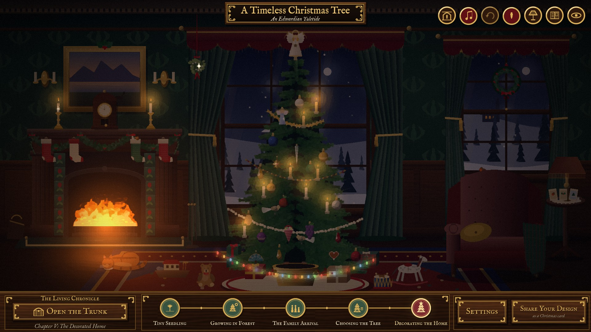
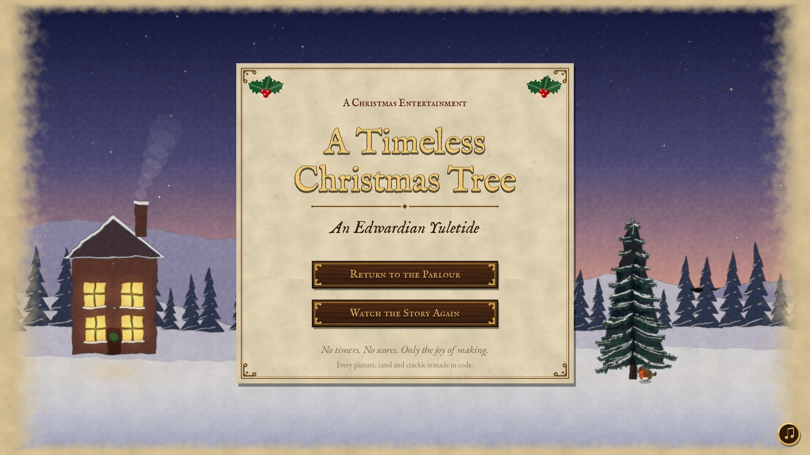
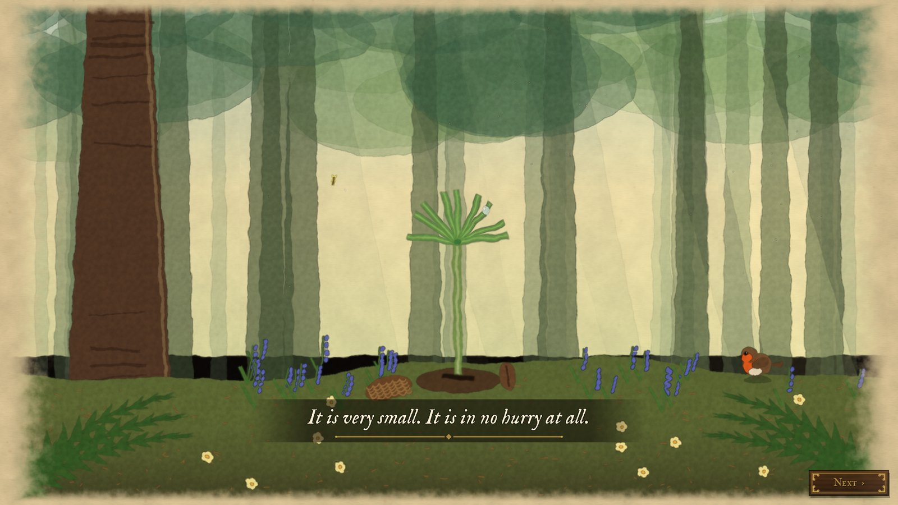
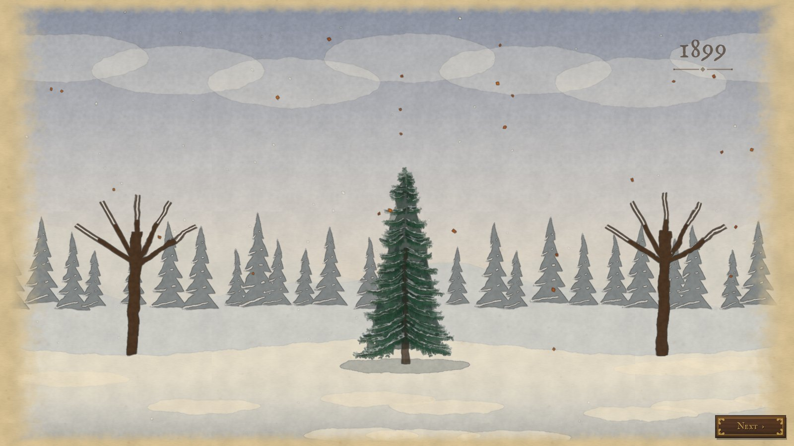
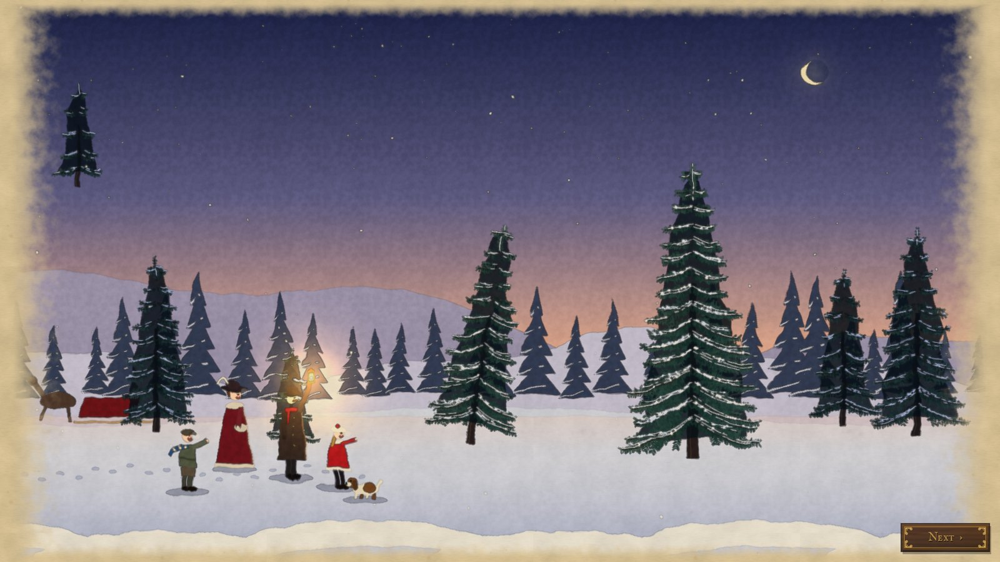
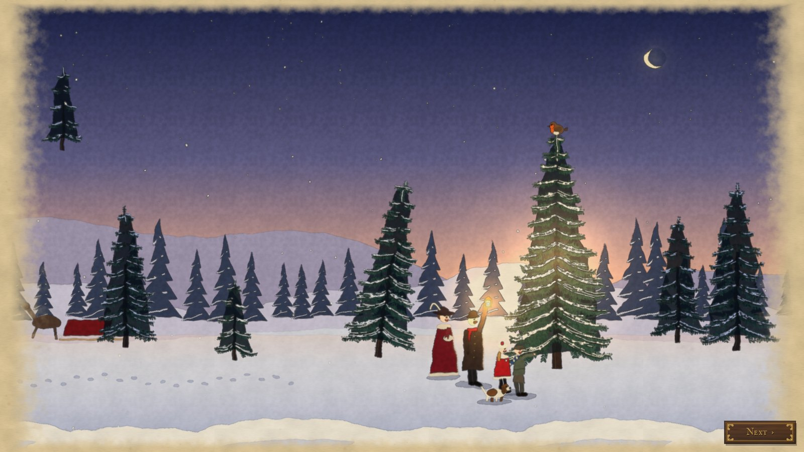
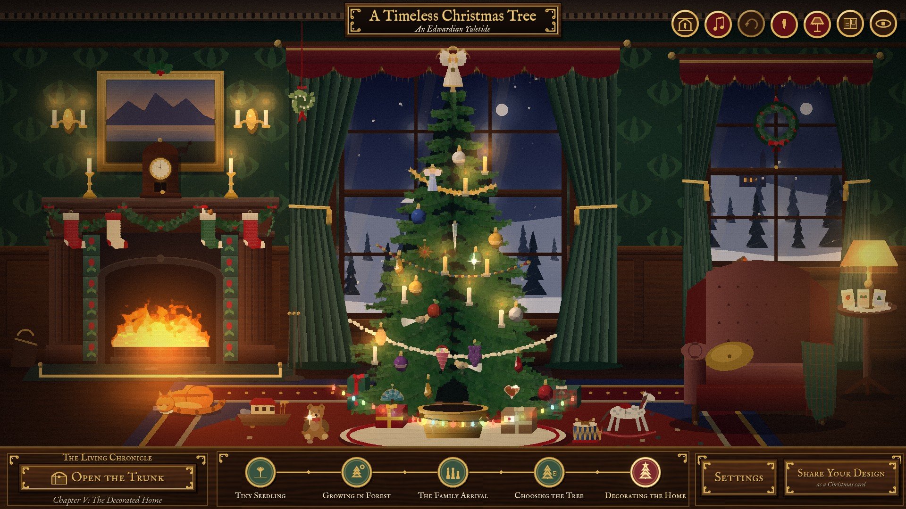
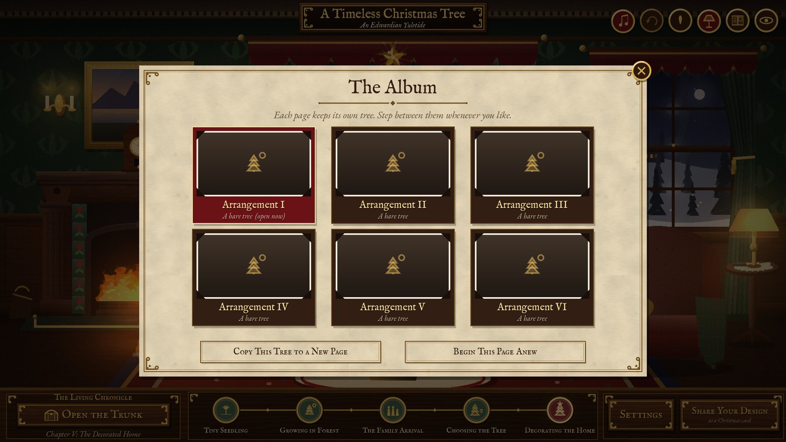
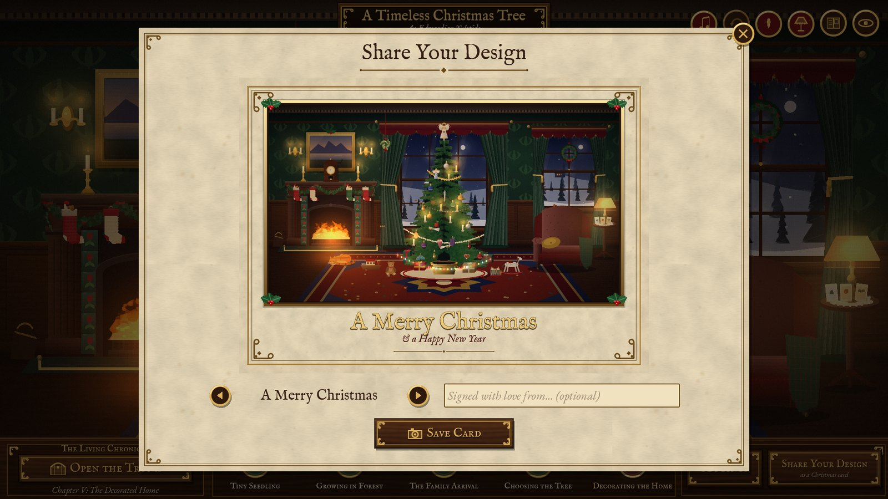
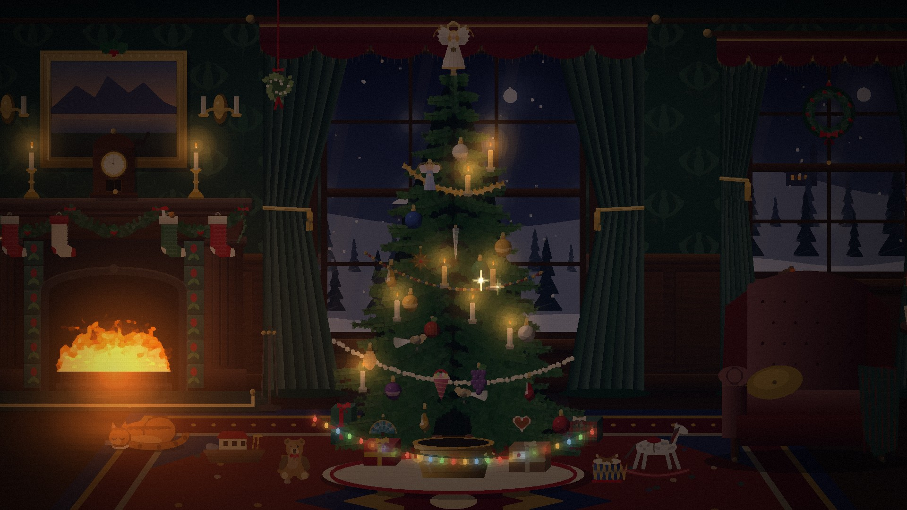

# A Timeless Christmas Tree: An Edwardian Yuletide



A cosy, stress-free Christmas game made in **Godot 4.5**. First you watch a short illustrated story: a pine seedling sprouts in a wood beneath the Mourne Mountains, grows through eight years of seasons, and is chosen by an Edwardian family on Christmas Eve, 1901. Then you decorate it in a candlelit parlour, using period ornaments from a vintage trunk.

There are no timers, budgets or scores.

**Everything is generated in code**: the pictures, the carols, the crackle of the fire and the chime of the glass baubles. The project contains no image or audio files. The only assets are two open-licence typefaces.

---

## Play it

| Where | How |
|---|---|
| **Browser** | Turn on GitHub Pages for this repo (*Settings → Pages → Deploy from a branch → `main` / `/docs`*). The game will then be at **https://jamesbell2021.github.io/timeless-christmas-tree-/** |
| **Godot editor** | Open `project.godot` in Godot **4.5 or newer** and press **F5**. |
| **itch.io** | Zip the *contents* of `docs/` and upload it as an HTML game. Set the viewport to 1600 × 900 and tick *Fullscreen button*. You don't need *SharedArrayBuffer support*, because this is a single-threaded build. |

### Controls

| Action | Mouse / touch | Keys |
|---|---|---|
| Open the trunk | **Open the Trunk** button | `T` |
| Place a decoration | Drag it from the trunk onto the tree or into the room | |
| Move a decoration | Drag it | |
| Put a decoration away | Right-click it, or drag it back to the trunk | |
| Re-drape a garland | Drag either of its brass end rings | |
| Light the tree / the lamps | Flame / lamp roundels (top right) | `C` / `L` |
| Undo | Curved-arrow roundel | `Ctrl+Z` |
| Admire the view | Eye roundel | `H` |
| Fireside mode (screensaver) | Hearth roundel | `F` |
| Music on/off | Note roundel | `M` |

Sweep the pointer quickly through the branches to set the ornaments swinging.

---

## What's in it

**Act I: The Living Chronicle** (watercolour illustration style)
1. **The Tiny Seedling**, spring 1893. In a close, low view of the woodland floor, a seed cracks open, the stem rises, the husk drops and the first needles unfurl. A robin comes to look.
2. **Growing in the Forest**, 1894–1901. A montage of summer sun, autumn gales, winter snow and spring rain, while the tree grows from knee-high to a fine young fir.
3. **The Family Arrival**, Christmas Eve 1901. Sleigh bells at dusk, and a family walks into the snowy clearing by lantern light.
4. **Choosing the Tree**. One tree is too small and another rather crooked. Then the lantern is raised over *ours*, and the robin settles on its very top.

**Act II: The Decorated Home** (oil-on-canvas style)
- **The Trunk**: 54 period decorations in six velvet-lined trays: candles and early electric lamps; Lauscha blown glass; Dresden paper stars, gingerbread and clove oranges; garlands of tinsel, popcorn, cranberries and glass beads; four tree toppers; and things for the room (stockings, parcels, a teddy bear, a rocking horse, a wreath, mistletoe and more). Each one has a short line of history in its tooltip.
- **Placement rules**: each item has a sensible home. Ornaments go on the boughs and toppers snap to the apex. Stockings snap to the mantel hooks, candlesticks stand on surfaces, parcels go on the floor (and behind the lowest branches if you set them there) and mistletoe hangs from the ceiling.
- **Lighting**: light the tree candle by candle (a little ceremony), or dim the lamps for a firelit evening.
- **The Timeline**: five gilt roundels showing the tree's life. Click any chapter you have reached to watch it again.
- **The Album**: six pages, each holding its own arrangement, with photograph thumbnails. You can copy a tree to a new page or start afresh. This is how you switch between different finished designs.
- **Share Your Design**: takes a snapshot of the parlour and frames it as a vintage Christmas card, with a gilt border, holly, a choice of greeting and an optional "with love from…". It downloads as a PNG in the browser, or saves to *Pictures* on desktop.
- **Fireside mode**: turns your parlour into a screensaver. The interface goes away, the lamps dim, the candles are lit and the view drifts slowly round the room. If the Album holds more than one decorated tree, it turns the page every few minutes. It starts from the hearth roundel, the `F` key, the title page, or by itself after five quiet minutes (you can turn that off in Settings). Click, tap or press any key to come back. On the web it also asks the browser to keep the screen awake.
- **Twinkle**: glints of candlelight catch on the ornaments, more of them the more you hang.
- **Saved automatically**, including on the web (in the browser's storage).

**Sound**
- Five public-domain carols played softly on a synthesised piano and harp, each played twice with a lighter second verse: *O Tannenbaum*, *Silent Night*, *Good King Wenceslas*, *Deck the Hall* and *We Wish You a Merry Christmas*.
- A crackling fire, wind round the house, birdsong in spring, sleigh bells, and a different sound for glass, paper, wood and parcels.

| | |
|---|---|
|  |  |
|  |  |
|  |  |
|  |  |
|  | |

---

## How it's built

```
Title ──► I Seedling ──► II Forest ──► III Arrival ──► IV Choosing ──► Parlour
                ▲                                                        │
                └──────────── timeline: replay any reached chapter ◄─────┘
```

```
scripts/
  autoload/   GameState (save data, settings, album), Tex (procedural textures),
              AudioDirector (buses, carol sequencer, ambience, SFX)
  core/       Catalogue (every decoration as data)
  decor/      DecorManager (drag & drop, undo, save), Decoration, Garland,
              Placement (pure placement rules)
  art/        TreeArt (procedural fir), DecorArt (every ornament), Room* (the parlour),
              Figure (the family), Robin, Flame, LightGlow, Twinkle, Snowfall, Painter
  audio/      Synth (Karplus-Strong strings, bells, noise; resumable render jobs), Carols
  scenes/     Main (scene director), TitleScreen, StoryScene + four chapters, Parlour, PostFX
  ui/         UIKit (fonts, palette, carved-wood panels), OrnateButton, TrunkPanel,
              TimelineBar, AlbumPanel, ShareOverlay, SettingsPanel, Caption, CursorHint
shaders/      painterly (Kuwahara oil-paint filter), watercolour, fire
tests/        test_runner (unit + flow), probe_drag (real mouse input), shots (screenshots)
```

The main patterns, which work well as teaching examples:

- **Data-driven content.** `Catalogue` holds every decoration as a dictionary. To add an ornament, add one entry, plus one draw routine in `DecorArt` if it needs a new look. Nothing else has to change.
- **Pure rules, separate from nodes.** `Placement.resolve()` takes an item and a position and returns *valid?, snap point, layer*. It has no scene dependencies, so the tests can exercise it directly.
- **Procedural art that stays cheap.** Godot caches `_draw()` commands, so static scenery is drawn once. The fir is about 25,000 needle strokes sent in three `draw_multiline_colors` calls. Only things that move redraw each frame.
- **Lighting by blending.** A multiply layer darkens the room, and additive `LightGlow` sprites (fire, candles, lamps, bulbs) sit on top. This gives the "pools of warm light" look without any 2D lights.
- **Post-processing for style.** The parlour goes through a 4-sector Kuwahara filter with canvas weave and a warm grade. The story goes through a watercolour filter with wobble, edge pooling, granulation and a deckled paper border. The UI sits on its own `CanvasLayer` above the filter, so text stays crisp.
- **Audio without files.** Piano and harp notes are Karplus-Strong plucked strings, tuned to within a cent and checked by FFT. They render a few thousand samples per frame through resumable jobs, so the web build never freezes. The sequencer arranges each melody over its chord chart (waltz, march or rolling arpeggio).
- **Adaptive quality.** If the full oil-paint filter can't hold a smooth frame rate, the parlour steps down to lighter brushwork once and tells the player. They can change it in *Settings*.

---

## Tests

```bash
# 743 checks: catalogue, placement rules, save/undo, carols (every bar adds up), synth, full scene flow
godot --headless --path . res://tests/test_runner.tscn

# Needs a display: drags real mouse input from the trunk onto the tree and into the room
godot --path . res://tests/probe_drag.tscn

# Needs a display: saves screenshots of every screen to tests/out/
godot --path . res://tests/shots.tscn
```

## Exporting

`export_presets.cfg` has three presets:
- **Web** builds to `docs/`. This is committed, so GitHub Pages can serve it.
- **Windows Desktop** and **Linux** build to `builds/`, which is git-ignored.

Install the Godot 4.5 export templates (*Editor → Manage Export Templates*), then use *Project → Export*.

---

## Credits and licences

- **Typefaces:** *IM Fell English* by Igino Marini and *EB Garamond* by Georg Duffner and Octavio Pardo. Both are under the SIL Open Font License 1.1 (see `assets/fonts/`).
- **Music:** traditional and public-domain carol melodies, arranged and synthesised in code.
- **Everything else** (art, animation, sound effects, ambience) is generated procedurally by the scripts in this repository.
